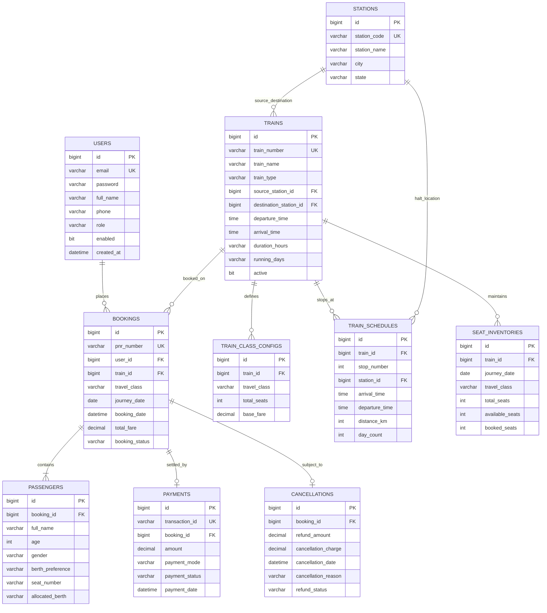

# RAILBOOK – Railway Reservation System

[](https://adoptium.net/)
[](https://spring.io/projects/spring-boot)
[](https://spring.io/projects/spring-security)
[](https://mariadb.org/)
[](https://getbootstrap.com/)
[](https://www.thymeleaf.org/)
[](LICENSE)

**RAILBOOK** is a production-grade, enterprise-ready Railway Reservation and Passenger Ticketing Management System inspired by modern IRCTC portals and contemporary SaaS travel booking platforms. Engineered in **Java 21** using **Spring Boot**, **Spring Data JPA**, **Spring Security**, **MariaDB**, and **Thymeleaf**, it provides high-concurrency ticket reservation with pessimistic locking, real-time class-wise seat inventory management, 10-digit Indian Railway format PNR tracking, automated refund calculations, user and admin dashboards, and printable and downloadable PDF e-tickets.

---

## Table of Contents
1. [Project Overview](#project-overview)
2. [Key Features](#key-features)
3. [Technology Stack](#technology-stack)
4. [System Architecture](#system-architecture)
5. [Database Architecture & Schema](#database-architecture--schema)
6. [Concurrency & Transaction Management](#concurrency--transaction-management)
7. [Installation & Setup Guide](#installation--setup-guide)
8. [Configuration & Environment Variables](#configuration--environment-variables)
9. [Running the Application](#running-the-application)
10. [Default Demo Credentials](#default-demo-credentials)
11. [Booking Workflow & Simulated Payment](#booking-workflow--simulated-payment)
12. [Cancellation & Simulated Refund Policy](#cancellation--simulated-refund-policy)
13. [E-Ticket & PDF Generation](#e-ticket--pdf-generation)
14. [Admin Management Modules](#admin-management-modules)
15. [Automated Testing & Concurrency Verification](#automated-testing--concurrency-verification)
16. [Future Scope](#future-scope)
17. [License & Acknowledgments](#license--acknowledgments)

---

## 1. Project Overview

RailBook provides an end-to-end railway reservation experience designed for academic major projects, technical viva, developer portfolio showcases, and engineering demonstrations:

- **End-to-End Ticketing**: From search, real-time availability check, multi-passenger detail entry, and berth allocation, to simulated payments, unique PNR generation, and PDF download.
- **High-Concurrency Seat Inventory**: Database-backed pessimistic write locks (`SELECT ... FOR UPDATE`) prevent double bookings and race conditions when multiple users book the last available seats simultaneously.
- **Dual Dashboards**: Dedicated User Dashboard (upcoming trips, past bookings, instant cancellation, profile management) and an Administrative Control Center (fleet management, station catalog, schedule halts, seat inventory quotas, cancellations audit, and user directory).

---

## 2. Key Features

### 🚄 Train Search & Discovery
- Station-to-station train search by Origin Code, Destination Code, and Journey Date.
- Interactive Station Swap button (`⇄`) with real-time station dropdown matching.
- Class-wise fare comparison (`1A`, `2A`, `3A`, `CC`, `EC`, `SL`) and real-time seat availability counts.
- Route schedule inspection displaying intermediate halts, arrival/departure timings, day count, and cumulative track distance.

### 🔒 Concurrency-Safe Booking Engine
- **Multi-passenger Booking**: Support for 1 to 6 passengers per reservation with age, gender, and berth preferences (Lower, Middle, Upper, Side Lower, Side Upper, Window).
- **Automated Berth & Seat Allocation**: Computes coach and seat numbering (e.g. `C1-14`, `B1-21`, `H1-04`) with berth alignment.
- **Pessimistic Locking**: Prevents overbooking and ensures inventory consistency across distributed threads.

### 🎫 10-Digit Unique PNR & Tracking
- Algorithmic generation of 10-digit Indian Railway standard PNR codes.
- Public PNR enquiry portal displaying live status (`CONFIRMED`, `CANCELLED`), passenger coach/seat allocations, and travel timings.

### 🔄 Cancellation & Time-Based Refund Policy
- One-click ticket cancellation from user dashboard or admin console.
- Simulated cancellation charges and refund calculation based on time remaining until departure:
  - $\ge 48\text{ hours}$: $80\%$ simulated refund ($20\%$ clerkage fee).
  - $24\text{ to }48\text{ hours}$: $75\%$ simulated refund.
  - $12\text{ to }24\text{ hours}$: $50\%$ simulated refund.
  - $< 12\text{ hours}$ until departure: $25\%$ simulated refund.
  - After train departure: $0\%$ refund.
- Immediate automated seat inventory restoration back to the pool.

### 📄 Official E-Ticket & Server-Rendered PDF
- IRCTC-styled Electronic Reservation Slip (ERS) with print-ready stylesheet (`@media print`).
- On-the-fly binary PDF generation via OpenPDF (`/ticket/{pnr}/pdf`) including barcode styling, passenger roster, and fare audit.

### 🛡️ Authentication & Security
- **Spring Security** integration with form login, secure session management, and CSRF token enforcement on all mutation requests.
- **BCrypt** password encryption with 10 salt rounds (no plain-text passwords stored).
- Dual Role-Based Access Control (`ROLE_USER` and `ROLE_ADMIN`).
- Duplicate email prevention and comprehensive input validation.

### ⚙️ Administrative Control Center
- **Train Fleet Management**: Add, update, activate/deactivate trains, and configure multi-class seating and base ticket fares.
- **Station Directory**: Add and manage station codes, cities, and states.
- **Intermediate Halts & Schedules**: Add and remove sequential stops along train routes with arrival/departure timings and distance.
- **Live Seat Inventory**: Inspect and manually adjust coach capacities and available seats across dates.
- **User Directory**: View registered accounts, toggle active status, and promote/demote roles.
- **Reservation Audit**: Audit confirmed and cancelled reservations with simulated revenue statistics.

---

## 3. Technology Stack

| Layer | Technology | Details |
|---|---|---|
| **Language** | Java 21 LTS | Eclipse Temurin JDK 21 |
| **Framework** | Spring Boot | Spring MVC, Spring Data JPA, Spring Security |
| **Database** | MariaDB 12.3.2 | InnoDB Engine on Port 3306 |
| **Driver** | MariaDB Connector/J | Optimized MariaDB native JDBC driver |
| **ORM** | Hibernate ORM 7.x | JPA Specification with pessimistic row locking |
| **Template Engine** | Thymeleaf 3 | Layout fragments, Spring Security extras |
| **Frontend Styling** | Bootstrap 5.3.3 | Bootstrap Icons 1.11.3, Inter Font, Custom Theme |
| **PDF Generation** | OpenPDF 2.0.3 | Native PDF rendering for e-tickets |
| **Build & Test Tool**| Apache Maven 3.9+ | JUnit 5, Mockito, Spring Security Test |

---

## 4. System Architecture

```mermaid
flowchart TD
    Client["Web Browser / Mobile Client"]

    subgraph Presentation_Layer["Presentation Layer (Spring MVC + Thymeleaf)"]
        HomeController["HomeController (Landing & Search Widget)"]
        SearchController["TrainSearchController (Availability)"]
        BookingController["BookingController (Ticketing & PDF)"]
        PnrController["PnrController (PNR Tracking)"]
        DashboardController["UserDashboardController (My Bookings)"]
        AdminController["AdminController (Fleet & Inventory)"]
        Auth["AuthController & Spring Security"]
    end

    subgraph Service_Layer["Service Layer (Transactional Business Logic)"]
        BookingService["BookingService (Locking & Reservation)"]
        TrainService["TrainService (Search & Halts)"]
        SeatService["SeatInventoryService (Pessimistic Locking)"]
        CancelService["CancellationService (Refund Calculation)"]
        PdfService["PdfTicketService (OpenPDF Engine)"]
        UserService["UserService (BCrypt & Profile)"]
    end

    subgraph Data_Layer["Data Access Layer (Spring Data JPA)"]
        BookingRepo["BookingRepository"]
        TrainRepo["TrainRepository"]
        SeatRepo["SeatInventoryRepository"]
        CancelRepo["CancellationRepository"]
        UserRepo["UserRepository"]
        StationRepo["StationRepository"]
    end

    subgraph Database["Relational Database (MariaDB 12.3.2)"]
        DB[(railbook_db)]
    end

    Client --> Presentation_Layer
    Presentation_Layer --> Service_Layer
    Service_Layer --> Data_Layer
    Data_Layer --> Database
```



---

## 5. Database Architecture & Schema

The relational database schema is structured into 10 normalized JPA entities:



---

## 6. Concurrency & Transaction Management

To prevent double booking when high traffic rushes to reserve limited seats, RailBook utilizes **database-level pessimistic locking**:

```java
@Lock(LockModeType.PESSIMISTIC_WRITE)
@Query("SELECT s FROM SeatInventory s WHERE s.train = :train AND s.journeyDate = :journeyDate AND s.travelClass = :travelClass")
Optional<SeatInventory> findWithLockByTrainAndJourneyDateAndTravelClass(
        @Param("train") Train train,
        @Param("journeyDate") LocalDate journeyDate,
        @Param("travelClass") TravelClass travelClass
);
```

### Execution Flow:
1. When a reservation request arrives, `BookingServiceImpl` opens a `@Transactional(isolation = Isolation.READ_COMMITTED)` boundary.
2. `findWithLockByTrainAndJourneyDateAndTravelClass` executes an atomic `SELECT ... FOR UPDATE` against MariaDB.
3. MariaDB acquires an exclusive row lock on that specific `(train_id, journey_date, travel_class)` row in `seat_inventories`.
4. Any competing threads pause until the locking transaction finishes:
   - If `availableSeats >= requestedSeats`, the count is decremented, passengers are allocated seats, and the transaction commits.
   - If insufficient seats remain, `SeatNotAvailableException` is thrown and the transaction rolls back without deducting seats.
5. Concurrent stress tests (`BookingConcurrencyIntegrationTest`) demonstrate zero overbooking across simultaneous parallel threads.

---

## 7. Installation & Setup Guide

### Prerequisites:
- **Operating System**: macOS, Linux, or Windows
- **Java Development Kit**: JDK 21 LTS (Temurin recommended)
- **Database Engine**: MariaDB 10.x / 11.x / 12.x or MySQL 8.x running on port `3306`
- **Build Tool**: Maven 3.9+ (or use the included `./mvnw` wrapper)

### Step 1: Clone the Repository
```bash
git clone https://github.com/your-username/railbook.git
cd railbook
```

### Step 2: Configure MariaDB
Start your MariaDB service:
```bash
# macOS (Homebrew)
brew services start mariadb

# Linux (systemd)
sudo systemctl start mariadb
```

Verify that MariaDB is accessible on port 3306:
```bash
mariadb -u root -p
```

Create the database (optional, as Spring Boot will auto-create if configured):
```sql
CREATE DATABASE IF NOT EXISTS railbook_db CHARACTER SET utf8mb4 COLLATE utf8mb4_unicode_ci;
```

---

## 8. Configuration & Environment Variables

Database credentials can be customized via environment variables or inside `src/main/resources/application.properties`:

| Property | Default Value | Environment Variable | Description |
|---|---|---|---|
| `server.port` | `8080` | `PORT` | Web server listening port |
| `spring.datasource.url` | `jdbc:mariadb://127.0.0.1:3306/railbook_db` | `DB_URL` | MariaDB JDBC connection string |
| `spring.datasource.username`| `root` | `DB_USERNAME` | Database username |
| `spring.datasource.password`| *(empty)* | `DB_PASSWORD` | Database password |
| `railbook.demo-data.enabled`| `true` | `DEMO_DATA_ENABLED` | Pre-seeds sample trains, stations & accounts |

---

## 9. Running the Application

### Using the Maven Wrapper:
```bash
./mvnw clean spring-boot:run
```

Once started, open your web browser and navigate to:
```
http://localhost:8080
```

---

## 10. Default Demo Credentials

When `railbook.demo-data.enabled=true`, demonstration accounts are automatically initialized with encrypted BCrypt credentials:

| Role | Email Address | Password | Permissions |
|---|---|---|---|
| **System Admin** | `admin@railbook.com` | `admin123` | Full access to Admin Portal, fleet, inventory, schedules, users & bookings |
| **Passenger User** | `user@railbook.com` | `user123` | Search trains, book tickets, cancel reservations, track PNR, edit profile |

> **Quick Login Helper**: On the login page (`/login`), click the **Admin** or **User** demo credential buttons to autofill credentials instantly.

---

## 11. Booking Workflow & Simulated Payment

1. **Search**: Enter Source (e.g. `NDLS`), Destination (e.g. `LKO`), and Date.
2. **Review Classes**: Select an available class (`CC`, `1A`, `2A`, `3A`, `SL`, `EC`).
3. **Passenger Details**: Add up to 6 passengers per booking. Total fare updates dynamically via JavaScript.
4. **Payment Selection**: Select payment method (`UPI`, `DEBIT_CARD`, `CREDIT_CARD`, `NET_BANKING`).
5. **Confirmation**: A unique 10-digit PNR is generated, seats are locked, and the confirmed reservation slip is displayed.

---

## 12. Cancellation & Simulated Refund Policy

Users can cancel confirmed reservations directly from **My Bookings** (`/my-bookings`):
- Click **Cancel** on any confirmed reservation to open the confirmation modal.
- The system computes the simulated refund and clerkage fee according to departure lead time.
- Upon cancellation:
  - Booking status changes to `CANCELLED`.
  - Seats are restored to `SeatInventory` in real time.
  - A cancellation audit record is generated.

---

## 13. E-Ticket & PDF Generation

- **Web E-Ticket**: Accessible at `/ticket/{pnr}`. Includes official styling, passenger coach/berth details, and simulated barcodes.
- **Print Version**: The "Print Ticket" button triggers `@media print` stylesheets that format the slip cleanly on standard A4 paper without headers or navbars.
- **Downloadable PDF**: Accessible at `/ticket/{pnr}/pdf`. Built with OpenPDF for instant server-side PDF generation.

---

## 14. Admin Management Modules

Accessible exclusively to users with `ROLE_ADMIN` at `/admin/dashboard`:

- **Train Fleet** (`/admin/trains`): Add new trains, edit timings, duration, running days, travel classes, capacities, and base fares.
- **Station Directory** (`/admin/stations`): Register station codes and names.
- **Route Halts & Schedules** (`/admin/trains/{id}/schedules`): Configure intermediate stops along any route with arrival and departure timings.
- **Seat Inventory Quotas** (`/admin/inventory`): Filter class-wise seat counts across journey dates and adjust capacity.
- **User Directory** (`/admin/users`): View all registered users, toggle active/disabled status, and adjust user roles.
- **Reservation Register** (`/admin/bookings`): Audit all customer bookings and inspect passenger rosters.
- **Cancellation Audit** (`/admin/cancellations`): Audit simulated refund amounts and cancellations.

---

## 15. Automated Testing & Concurrency Verification

RailBook includes comprehensive automated test suites:

```bash
./mvnw test
```

### Test Suite Summary:
- `TrainSearchAndBookingIntegrationTest`: Verifies train search, multi-passenger booking, PNR generation, cancellation, and seat restoration.
- `BookingConcurrencyIntegrationTest`: Spawns concurrent threads competing for the last available seats, validating pessimistic write locks and zero double bookings.
- `AdminAuthorizationIntegrationTest`: Verifies Spring Security URL authorization rules (protecting `/admin/**` from unauthorized users).
- `UserServiceTest`: Verifies user registration, BCrypt password hashing, profile updates, and duplicate email prevention.

---

## 16. Future Scope
- Live Indian Railway API integration for actual train GPS tracking.
- Production payment gateway integration (Razorpay / Stripe).
- Automated SMS and WhatsApp confirmation notifications via Twilio.
- Waiting list (WL) and Reservation Against Cancellation (RAC) automatic berth upgrading.
- Multi-station intermediate segment booking engine.

---

## 17. License & Acknowledgments

This project is developed as a complete academic and demonstration railway reservation platform. Distributed under the MIT License.
